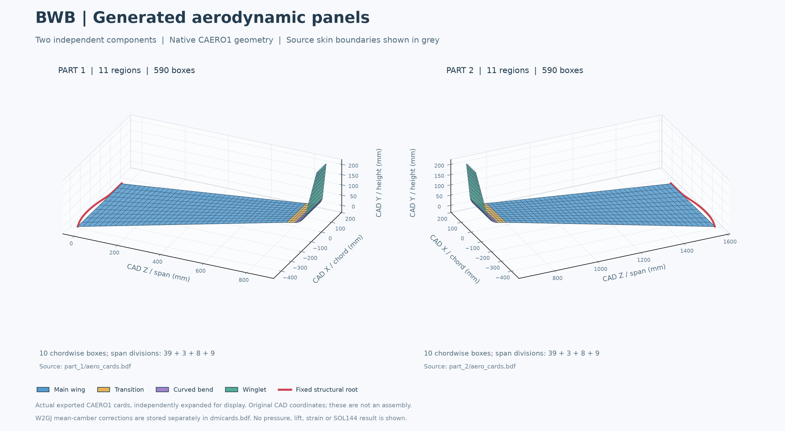

# BWB 气动面板与结构连接

本目录把现有规则蒙皮转换为可检查的 Nastran 气动输入，并保留独立的 Femap 查看模型。输入包包含几何、结构连接和几何初始下洗；没有指定 SOL、TRIM、速度、Mach 或动压，也没有运行 SOL144。它不是升力、变形或应变计算结果。

在本目录之外，已建立 [完整演示工况](../../cases/sol144_demo/README.md) 并得到 [实际 SOL144 应变结果](../../results/sol144_demo/README.md)。本目录继续只负责可复用几何输入。实际求解发现并修复了 W2GJ 的写出方式：590 值现为一个连续 DMI 列，双精度使用 D 指数；数值及几何没有因此改变。

两件保持原 CAD 坐标、各自根部固支并单独输出。预览中的并排显示不代表已经确定装配位置；本次没有建立两件之间的气动干扰模型。



## 分区与数量

每件使用同一个 PAERO1、同一个干扰组 IGID，分区之间保留气动相互影响。气动面只是一层参考升力面；上下蒙皮、后缘闭合条和翼尖封口不会各自复制成气动面。

| 区域 | CAERO1 大面 | 每个大面弦向 × 展向 | 小面板 |
|---|---:|---:|---:|
| 主翼 | 1 | 10 × 39 | 390 |
| 短过渡 | 1 | 10 × 3 | 30 |
| 弯折区 | 8 | 10 × 1 | 80 |
| 翼梢 | 1 | 10 × 9 | 90 |
| 每件合计 | 11 | | 590 |

每个 CAERO1 配一个局部 SPLINE1 和一个 SET1，共 11 组；每个气动小面板对应一个 W2GJ 项，共 590 项。当前每件主翼样条选择 77 个节点、短过渡 28 个、各弯折小面 14 个、翼梢 70 个；相邻样条可以共享结构节点，但不重复覆盖气动小面板。分区是几何与插值的组织方式，不是损伤类别。后续 SHM 损伤区域仍应由结构单元定义。

## 从结构几何到气动输入

1. 读取 `../skin_structured/part_N/part_N_skin.bdf` 与 `mesh_layout.json`。逐分区使用已保存的上下蒙皮行列配对；不修改源 CAD、源结构 BDF 或已有 `.modfem`。
2. 提取平均线、前缘和弦长。CAERO1 的弦向边必须平行于来流，因此按主翼、过渡、8 个弯折小平面和翼梢建立参考升力面；它是用于线性势流计算的几何简化，不是完整翼型外表面。
3. 为每个大面选择附近、覆盖弦向和展向的结构节点，生成 SET1/SPLINE1。当前选取局部法向正侧的一层蒙皮，避免将上、下蒙皮投影几乎重合的节点同时输入同一个表面样条。每个气动小面板只归属一个连接。这是初始连接方案；将全部面板载荷经单侧蒙皮节点传递时，局部应变可能依赖支撑选取，不能据此宣称蒙皮局部应变准确。
4. 在每格控制点计算平均线相对参考面的顺流斜率，形成 W2GJ。这样弯度和初始扭转不会因为参考面被展平而丢失。
5. 从源结构 BDF 提取结构 bulk 卡片，保留节点、单元、材料、属性和根部约束，移除源交换文件的执行/工况控制段。用独立 INCLUDE 文件汇总为导入 deck，再从导出的实际卡片进行检查。
6. 通过 Femap COM 导入为原生 Aero Panel 与 Aero Spline，并另存本目录 `.modfem`。气动面板不会伪装成承担刚度/质量的 CQUAD4 壳单元；分析输入以本目录 BDF 为准。查看模型默认只显示气动面板以便辨识，结构实体仍保存在模型中，可以切换显示；生成时使用 `--show-structure` 可直接叠加结构。

原结构仍采用 m-N-kg-s、铝材 E=69 GPa、ν=0.33、ρ=2700 kg/m³、PSHELL 厚度 1 mm 等演示假设。气动输入增加了 AEROS 参考几何量，没有增加真实飞行工况或材料验证。SREF 是单件包括翼梢在内的水平投影面积，BREF 是单件的水平投影展长，CREF 是按该投影面积加权的平均气动弦长；这些参考量不代表整架飞机。AEROS 的两个对称标志均为 0，不自动增加镜像翼。

两件当前参考量相同：SREF=0.2614171901 m²、BREF=0.8702281 m、CREF=0.3218099256 m；参考面的展开面积为 0.2846035887 m²。面积约定应在未来 CFD/实验对比时保持一致。

## 坐标、方向与编号

CAD 坐标 X 为顺流弦向，Y 为主翼向上方向，Z 为主翼展向。AEROS 引用右手 CORD2R，三个气动基向量在 CAD 坐标中为：

```text
e_x = (1, 0, 0)
e_y = (0, 0, -1)
e_z = (0, 1, 0)
```

坐标原点位于各自根部 `(0, 0, Z_root)`；因此位置分量为 `(x_a, y_a, z_a) = (X, -(Z-Z_root), Y)`，方向分量对应 `(X, -Z, Y)`。当前 CAERO1 的 CP=0，前缘位置直接写在 CAD/结构基本坐标系中；其弦长方向由 AEROS 来流坐标系定义，不能将这两个坐标系混为一谈。

每个大面法向由实际端点定义：

\[
\mathbf n=\frac{\mathbf e_x\times(\mathbf P_4-\mathbf P_1)}
{\|\mathbf e_x\times(\mathbf P_4-\mathbf P_1)\|}.
\]

part1 将各分区的端点顺序反转；part2 保留 root→tip，使两件主翼法向都朝向 CAD +Y 一侧。弯折与翼梢按各自局部法向处理。镜像件的符号由各自几何和端点顺序决定，不额外对 W2GJ 取绝对值或添加经验反号。

小面板编号为 `EID + i_chord + NCHORD * i_span`，弦向先增加。单一 IGID、纯 CAERO1 的 j-set 向量按大面顺序、再按小面板顺序拼接；清单记录对应关系。未来添加 CAERO2、改 IGID 或修改排序时必须重建 W2GJ 映射。

## W2GJ 的定义与依据

对上下蒙皮的配对位置取平均：

\[
\mathbf r_m(\xi,\eta)=\tfrac12
\left(\mathbf r_{upper}(\xi,\eta)+\mathbf r_{lower}(\xi,\eta)\right).
\]

对于小面板范围 `[ξ0, ξ1] × [η0, η1]`，控制点位于该小面板内部的 75% 弦长和 50% 展长：

\[
\xi_j=\xi_0+0.75(\xi_1-\xi_0),\qquad
\eta_j=\tfrac12(\eta_0+\eta_1).
\]

这不是整片机翼的 75% 弦长，也不是压力集中位置的 25% 弦长。令 `h` 为平均线沿该 CAERO1 局部法向的高度，按线性小扰动约定：

\[
W2GJ_j=-\frac{\partial h}{\partial x}
=-\mathbf n\cdot\frac{\partial\mathbf r_m}{\partial x}
=-\frac{\partial h/\partial\xi}{\partial x/\partial\xi}.
\]

该无量纲坡度按小角度弧度解释。高度必须沿局部法向计算，不能对接近竖直的翼梢仍只取 CAD Y。W2GJ 仅包含几何初始弯度和扭转；未来若再指定 ANGLEA，须明确它相对当前 CAD 安装姿态定义，避免重复加入同一迎角。

实现使用配对平均线的实际 X 位置归一化弦坐标，对法向高度做 PCHIP 插值并求解析导数，再除以实际 X 弦长。展向在来源截面之间线性插值，截面位置由其平均前缘在大面前缘线段上的投影确定。这是本次明确选定的几何近似，并非 NASA 原始未知算法。

依据为本机 Siemens Femap 2406 自带手册（PDF 页码从 1 起）：

| 手册位置 | 本实现采用的内容 |
|---|---|
| `D:/Siemens/Femap 2406/nastranhelp/pdf/aero.pdf`，PDF21 / 1-7 | DLM j-set 控制点位于每格 75% 弦、展向中心 |
| 同上，PDF24 / 1-10 | 力集中于每格 1/4 弦，法向流动条件在 3/4 弦满足 |
| 同上，PDF43 / 1-29 | 气动面板斜率是位移斜率的负值 |
| 同上，PDF143 / 2-17 | j-set 按干扰组、CAERO1、大面内小面板组织 |
| 同上，PDF272 / 6-64 | SOL144 示例明确在每格 3/4 弦位置输入 W2GJ；正 10° 初始迎角输入 +0.17453 |
| `D:/Siemens/Femap 2406/nastranhelp/pdf/QRG.pdf`，PDF1376-1378 / 11-4 至 11-6 | CAERO1 字段、右手局部坐标与小面板编号 |

手册 `aero.pdf` PDF147 / 2-21 的一般性段落写了 box midchord，与上述理论定义和具体 SOL144 示例不一致；本实现采用明确的 DLM j-set 3/4 弦控制点。NASA `dmicards.bdf` 首行的 “pressure locations” 注释也不足以证明其原生成脚本采用了哪种采样位置。

## 与 NASA_SHM 的对应关系

| NASA_SHM 参考文件 | BWB 对应内容 | 复用范围 |
|---|---|---|
| `NASA_SHM/core/base/aero_cards.bdf` | `aero_cards.bdf` | CAERO1/PAERO1/AEROS 分文件组织 |
| `NASA_SHM/core/base/spline_cards.bdf` | `spline_cards.bdf` | SPLINE1 + SET1 的连接组织 |
| `NASA_SHM/core/base/dmicards.bdf` | `dmicards.bdf` | 用 DMI W2GJ 输入几何初始下洗 |

NASA 基准为 3 个 CAERO1、500 个气动小面板。其注释引用的 `create_aero_cards.m` 和 W2GJ 原始 MATLAB 生成流程不在当前仓库；本次参考现有卡片组织，并依据 BWB 实际几何重新生成，不能声称精确复刻未知算法。NASA 的坐标、W2GJ 数值、对称条件、单位、参考尺寸、TRIM 和结果不直接移用。来源文件与结构输入的路径和哈希记录在清单中，NASA_SHM 保持只读。

文本来源与生成器的主 SHA256 在将 CRLF 规范为 LF 后计算，避免 Git 在不同系统检出时仅改变换行而造成误报；清单同时保留生成时的原始字节 SHA256。Femap 导入报告则记录实际导入 BDF 的原始字节 SHA256，用于识别查看模型是否对应当前输入。

## 文件用途

两件各自保存在 `part_1/` 与 `part_2/`：

| 文件 | 用途 |
|---|---|
| `aero_cards.bdf` | CAERO1、PAERO1、右手坐标系与 AEROS 参考量 |
| `spline_cards.bdf` | 每个大面的 SPLINE1 与结构节点 SET1 |
| `dmicards.bdf` | 按 j-set 顺序排列的 590 项 W2GJ |
| `structural_cards.bdf` | 从原网格提取的结构 bulk 卡片 |
| `part_N_aero_structure.bdf` | 汇总上述 INCLUDE 的模型交换入口，无 SOL/TRIM |
| `aero_manifest.json` | 几何、方向、编号、输入来源及生成约定 |
| `aero_qa.json` | 独立读取导出卡片得到的检查结果 |
| `part_N_aero_structure.modfem` | Femap 原生气动面板/结构查看模型 |
| `femap_import_report.json` | Femap 导入数量、原生实体和几何核对记录 |

全局 `aero_panel_overview.png` 展示气动面与结构的空间关系，`aero_spline_support.png` 额外标出所选 SPLINE 结构节点。所有预览仅用于审查建模，不是求解后的压力或变形云图。

导出器对超过 8 字符的字段使用标准 16 列 large-field 格式，采用配对物理行、每行不超过 80 列；实数按 `.9E` 输出，保留 10 位有效数字。没有依靠超长 free-field 数值绕过 Nastran 字段规则。格式依据为本机 `User.pdf` 的印刷页 2-5 至 2-8，以及 `QRG.pdf` 的印刷页 9-5 至 9-9。

当前两件 Femap 导入报告均核实了 11 个原生 Aero Panel、590 个格子、11 个原生 Aero Spline、2940 个结构节点和 2915 个壳单元，没有增添伪气动壳单元。导入审查未发现 W2GJ 被保存在原生矩阵或分析文本中；因此 `.modfem` 只用于查看几何和连接，后续求解必须显式包含原始 `dmicards.bdf`，不能把从查看模型重新导出的 BDF 当作完整气动输入。

## 重建与检查

从仓库根目录运行。气动卡片生成依赖已有规则结构网格；Femap 原生查看模型另需本机 Femap 和桌面 COM，会话配置见 [BWB 说明](../../README.md)。

```powershell
python BWB/scripts/build_bwb_aero_panels.py --parts 1 2 --chord-divisions 10
python BWB/scripts/check_aero_panels.py BWB/models/aero_panels/part_1 --output BWB/models/aero_panels/part_1/aero_qa.json
python BWB/scripts/check_aero_panels.py BWB/models/aero_panels/part_2 --output BWB/models/aero_panels/part_2/aero_qa.json
python BWB/scripts/plot_aero_panels.py
python BWB/scripts/view_femap_aero_panels.py --deck BWB/models/aero_panels/part_1/part_1_aero_structure.bdf --manifest BWB/models/aero_panels/part_1/aero_manifest.json --output BWB/models/aero_panels/part_1/part_1_aero_structure.modfem
python BWB/scripts/view_femap_aero_panels.py --deck BWB/models/aero_panels/part_2/part_2_aero_structure.bdf --manifest BWB/models/aero_panels/part_2/aero_manifest.json --output BWB/models/aero_panels/part_2/part_2_aero_structure.modfem
python -m unittest discover -s BWB/tests -v
```

检查范围包括实际导出卡片的面板数量、坐标系右手性、面积与法向、ID 冲突、相邻面连续性、样条覆盖、结构节点分布及投影重复、W2GJ 维度/采样/符号和源文件哈希。程序检查与原生导入检查分别记录，只有实际生成的报告可以作为对应检查是否通过的依据。

当前两件 `aero_qa.json` 均为 PASS：每件 11 个大面、590 个小面板、10 个连续分区接口、11 个样条和 590 行 W2GJ；各核对 2 个 BWB 来源文件、5 个 NASA 参考文件及生成器哈希。W2GJ 从源蒙皮截面独立重算后与实际导出矩阵一致，当前范围约为 -0.129275 至 +0.074765 rad。输入检查的 PASS 只适用于本目录当前文件，不是求解或物理精度验证。

最终标准 large-field BDF 已重新导入 Femap，报告中的面板数量、划分、几何、样条及支撑节点 ID 与输入一致。BWB 的 11 项自动化测试和 NASA_SHM 的 19 项回归测试通过；两张预览图已检查。原生查看模型未保留 W2GJ 的限制仍按上文处理。

这些检查不等于已经验证求解器内部的样条传力矩阵、气动网格收敛、黏性/失速行为、材料厚度或真实应变。正式 SOL144 分析前还需确定飞行工况和边界条件，并检查刚体平移/转动传递、合力与合力矩、气动/结构网格收敛及 CFD 或实验对照。
