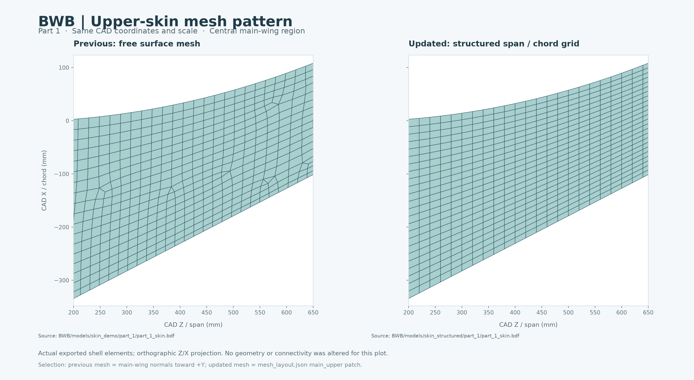

# BWB 规则展向/弦向蒙皮网格

当前生成脚本使用明确的二维节点行列，取代首版自由铺网。主翼弦向每排位于平行的 CAD Z 截面；展向每列保持同一相对弦长位置，并随实际机翼轮廓收缩。弯折区和翼梢保持相同列数，沿真实曲面接续。后掠、收缩和曲面曲率会使部分单元呈梯形或平行四边形。



## 当前模型

| 零件 | 原生 Femap 文件 | BDF | 节点 | 四边形 | 三角形 | 根部固定节点 |
|---|---|---|---:|---:|---:|---:|
| 1 | [part_1_skin.modfem](part_1/part_1_skin.modfem) | [part_1_skin.bdf](part_1/part_1_skin.bdf) | 2940 | 2914 | 1 | 49 |
| 2 | [part_2_skin.modfem](part_2/part_2_skin.modfem) | [part_2_skin.bdf](part_2/part_2_skin.bdf) | 2940 | 2914 | 1 | 49 |

每件包括2832个主体蒙皮四边形、59个后缘闭合带四边形、23个翼梢封口四边形和1个前缘厚度趋于零处的封口三角形。没有根部封口、内部肋板或体单元。两件独立保留原CAD坐标，分别从各自CAD投影，预览不表示装配姿态。

材料和约束沿用演示假设：m–N–kg–s；铝材 E=69 GPa、ν=0.33、ρ=2700 kg/m³；PSHELL厚度1 mm；外表面作为零偏置壳参考面。根部为零件1的z=0 m、零件2的z=1.56 m，六自由度固支。没有加载、求解、气动面板或SOL144配平。BDF的静力导出设置仅用于结构网格交换。

## 实现

- `BWB/scripts/structured_skin_grid.py` 定义8个蒙皮分区和共享边界。弦向24格；展向依次为主翼39格、短过渡3格、弯折8格、翼梢9格。
- 主翼以固定Z和相对弦长计算目标位置，通过Femap API沿厚度方向投影到裁剪曲面，并检查投影结果在曲面内。其他分区由四边界插值形成规则网格，再投影到CAD。
- 边界直接取CAD曲线上的点；接口共享节点编号。节点和单元通过Femap API写入并关联CAD，不进行自由铺网、随机平滑或自动节点合并。
- `mesh_layout.json` 保存逐区节点行列、单元分区及CAD关联；以后插入肋/梁可以复用已有截面节点，避免接口不连接。
- 后缘用对应上下边缘之间的规则条带闭合，微小CAD分缝被简化；surface14没有独立网格。跨越细小分缝的闭合单元可能不满足“全部节点关联同一CAD面”，因此构建报告分别记录分区归属数量与Femap按节点关联返回的数量。
- 法向先按共享边统一，再使用根平面上的参考原点判断向外方向。`virtual_root_cap_volume_m3` 是计算时假想封闭根口的网格体积；没有加入实体根部封口单元。

输入来源为 `../skin_demo/cad/1.x_t` 与 `2.x_t`；原始SLDPRT、副本哈希和API导出记录同目录保存。当前面/曲线编号映射针对这两个输入，换另一套CAD必须重新确认映射，不能直接泛用。

## 检查

两件导出BDF均通过独立布局与连接检查：

- 2530个主体蒙皮内部节点全部连接4个单元，分区间共节点；无反转或退化角点。
- 主翼每排Z差为0；展向间距20 mm；相对弦长等距误差不超过4.21×10⁻⁶（BDF小字段舍入）。
- 单个连通体，49条自由边全部位于固定根部；无额外裂缝、非流形边或方向冲突。
- 主翼最小角约63°；8个主体蒙皮区整体最小角约31.75°、最大边长比5.36，蒙皮最大简单对角翘曲角约6.13°。

薄后缘闭合带仍有最大约80的边长比，翼梢封口局部最大约17.4。这些细长闭合带的物理宽度很小，规则排列不等于已经完成求解质量验收；正式应变预测仍需要局部处理及网格收敛。主体蒙皮、后缘、封口的指标在 `structured_layout_qa.json` 中分别列出，避免把几何外观改善当作全部单元质量通过。

`mesh_qa.json` 检查整体结构卡和拓扑；`structured_layout_qa.json` 由独立脚本对导出BDF与索引网格逐单元比对。CAD节点投影检查由生成器执行，独立BDF检查不宣称验证曲面间连续误差。

## 运行

Windows、Femap、Python与依赖配置见 [BWB说明](../../README.md)。已有Parasolid输入可直接重建；首次SolidWorks导出仍使用 `export_skin_geometry.ps1`。从仓库根目录运行，并先保存、关闭已有同名目标模型：

```powershell
python BWB/scripts/build_femap_skin_demo.py --parts 1 2 --size 0.020 --chord-divisions 24
python BWB/scripts/inspect_shell_bdf.py BWB/models/skin_structured/part_1/part_1_skin.bdf --units m --root-plane z=0 --spc-set 1 --output BWB/models/skin_structured/part_1/mesh_qa.json
python BWB/scripts/inspect_shell_bdf.py BWB/models/skin_structured/part_2/part_2_skin.bdf --units m --root-plane z=1.56 --spc-set 1 --output BWB/models/skin_structured/part_2/mesh_qa.json
python BWB/scripts/check_structured_layout.py BWB/models/skin_structured/part_1 BWB/models/skin_structured/part_2
python -m BWB.scripts.plot_skin_demo BWB/models/skin_structured/part_1/part_1_skin.bdf BWB/models/skin_structured/part_2/part_2_skin.bdf
python BWB/scripts/plot_mesh_comparison.py
```

`--chord-divisions` 控制弦向格数，`--size` 控制展向目标间距，弯折区保留最低分段数。不同密度输出仍需重新运行检查；当前报告仅对应默认24列版本。
