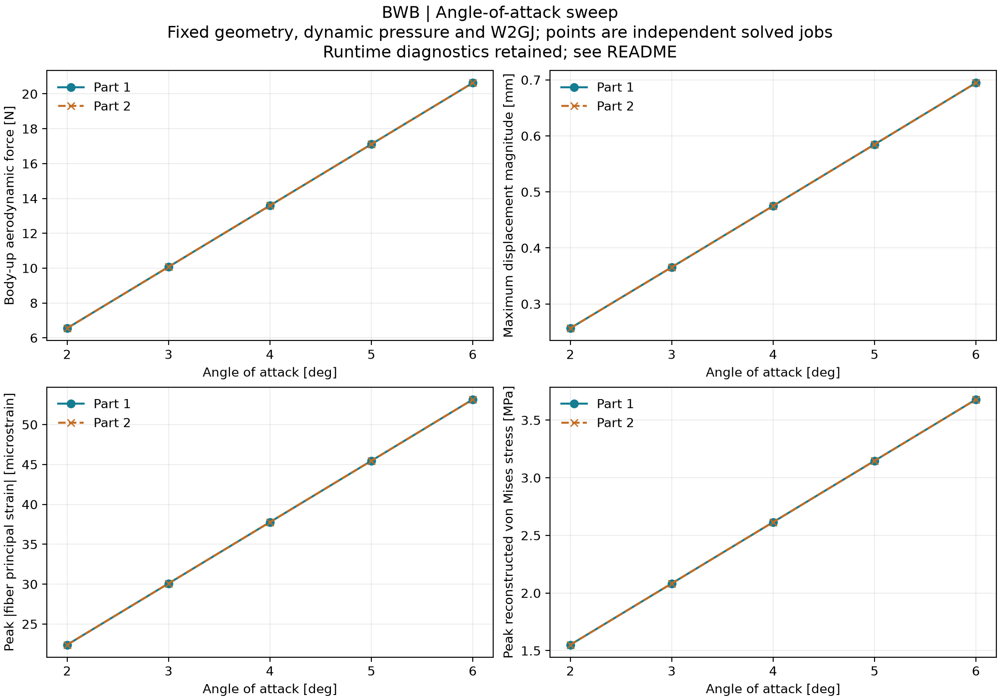

# BWB 迎角扫描

两个零件分别计算 3°、4°、5°、6°，并保留此前 2° 结果作为基线，共 10 组结果。各组是独立 SOL144 作业；根部固定、材料、结构、气动面板、SPLINE、W2GJ 和动压保持一致。
动压为 245 Pa。此处向上气动力为各独立零件的 CAD +Y 气动力；该方向与严格的风轴升力方向存在迎角差异。

| 迎角 | 向上气动力 1 / 2（N） | 最大位移 1 / 2（mm） | 最大纤维主应变绝对值 1 / 2（µε） | 峰值 von Mises 1 / 2（MPa） |
|---:|---:|---:|---:|---:|
| 2° | 6.55142 / 6.5514 | 0.256681 / 0.256679 | 22.394 / 22.3938 | 1.55092 / 1.55091 |
| 3° | 10.071 / 10.0709 | 0.365582 / 0.36558 | 30.0819 / 30.0817 | 2.08298 / 2.08297 |
| 4° | 13.5905 / 13.5905 | 0.475047 / 0.475045 | 37.7699 / 37.7698 | 2.61505 / 2.61504 |
| 5° | 17.11 / 17.11 | 0.584759 / 0.584758 | 45.458 / 45.4579 | 3.14713 / 3.14712 |
| 6° | 20.6296 / 20.6295 | 0.694602 / 0.6946 | 53.1462 / 53.146 | 3.67921 / 3.6792 |



逐节点平移、转角、逐单元三个表面的局部 exx/eyy/γxy 以及总气动力/根部力矩，均按 `a × α + b` 检查：全部通过。拟合保留截距，因为 W2GJ 包含初始弯度/扭转。最大位移模长、主应变和应力极值只汇总趋势，不强制线性或穿过原点。

mid 分量由已打印的上下纤维分量平均得到；当上下分量相消时，其打印舍入容差按母纤维幅值传播，不能按接近零的平均值缩小。

镜像变换后，10 组中的最大同节点位移差为 3.50927e-06 mm；同单元主应变最大差为 0.00463463 µε；两件向上气动力最大差为 1.28152e-05 N。位移和力使用极向量变换，转角和力矩使用轴向量变换；主应变比较不受局部单元轴差异影响。

各工况的力/力矩平衡、根部约束、小变形及假设屈服强度粗筛：全部通过。详细值见各零件目录的 `reasonableness.json`。

Femap 模型：

- [零件 1：3°–6°结果](part_1_aoa_3to6.modfem)
- [零件 2：3°–6°结果](part_2_aoa_3to6.modfem)

每件 Output Set 1–4 对应 3°、4°、5°、6°，默认显示 6°。Femap 默认 7071 是 top-major（正纤维侧最大主应变），6° 峰值约 40.1187 µε；表中的 53.1462 µε 是跨上下两纤维表面的最大主应变绝对值，来自 bottom 压应变。两者统计量不同。

8 个新工况的 case_review 均接受用于流程演示。
**运行诊断仍保留：10 组带有原始运行错误记录。** 数据完成标记和结果表完整，本汇总保留已审阅的诊断信息，不将这些作业标记为无错误求解。

- `Intel MKL ERROR: Parameter 13 was incorrect on entry to DGEMM .`
- `Launcher returned exit code 1`

文件：`aoa_summary.csv` 为工况指标，`mirror_comparison.csv` 为两件差异，`aoa_summary.json` 包含分量仿射性、输入校验和来源记录。这里只检查当前假设下的结果一致性与量级，不替代网格收敛、试验验证或强度认证。

复现汇总：

```powershell
python BWB/scripts/summarize_aoa_sweep.py
```
