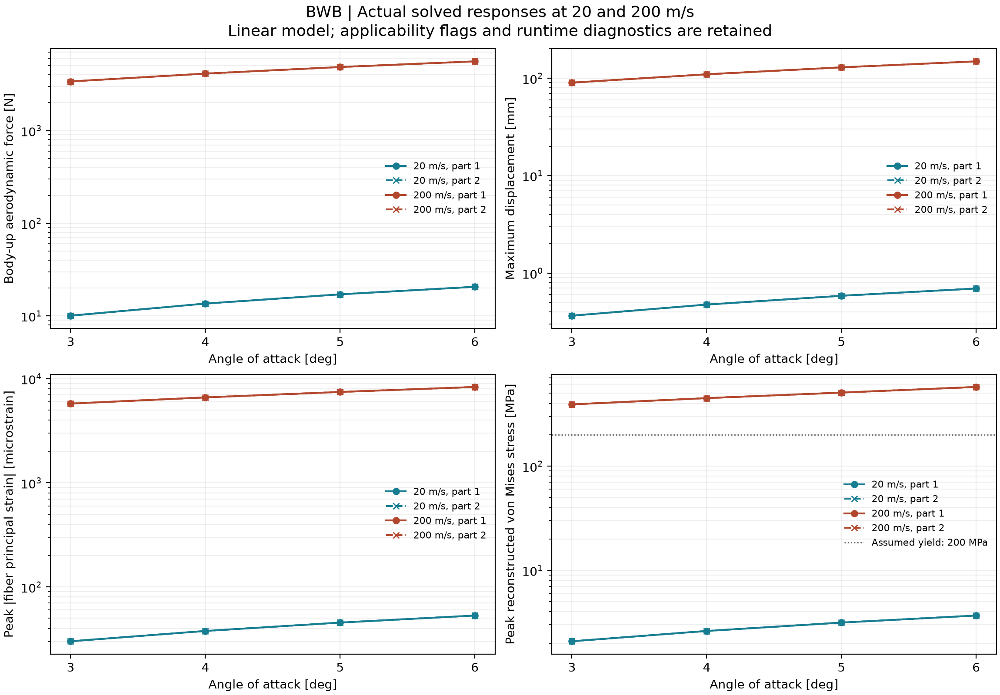

# BWB：200 m/s 与 20 m/s 求解结果比较

200 m/s 工况使用 Mach 0.5877167、动压 24500 Pa；密度 1.225 kg/m³、声速 340.3 m/s。两个零件各自固定根部，分别计算 3°、4°、5°、6°。结构仍为假设铝材、1 mm 蒙皮，无 rib/spar。

**8 组均超过假设 200 MPa 屈服及小变形筛查界限，以下为超出适用范围的线性输出。**

本汇总读取两个速度各自的实际 SOL144 输出。动压增加 100 倍，但 Mach 和气动弹性反馈也改变；表中响应没有按 100 倍推算。向上气动力是 CAD +Y 分量，方向与风轴升力存在迎角差异。

| 迎角 | 零件 | 向上气动力 N | 最大位移 mm | 最大绝对主应变 µε | 峰值 VM MPa | >200 MPa 单元数 |
|---:|---:|---:|---:|---:|---:|---:|
| 3° | 1 | 3385.8 | 90.0233 | 5762.32 | 391.233 | 524 |
| 3° | 2 | 3385.8 | 90.0233 | 5762.35 | 391.235 | 524 |
| 4° | 1 | 4116.38 | 109.618 | 6608 | 449.355 | 783 |
| 4° | 2 | 4116.37 | 109.618 | 6608.04 | 449.357 | 783 |
| 5° | 1 | 4846.95 | 129.213 | 7453.97 | 507.619 | 1119 |
| 5° | 2 | 4846.95 | 129.213 | 7454.01 | 507.622 | 1119 |
| 6° | 1 | 5577.53 | 148.808 | 8323.16 | 574.891 | 1375 |
| 6° | 2 | 5577.52 | 148.808 | 8323.15 | 574.89 | 1375 |



图的响应纵轴使用对数刻度，以同时显示两个速度；应力图虚线为假设的 200 MPa 屈服强度。

200 m/s 的 8/8 组结果超出至少一项小变形/弹性粗筛。粗筛采用最大位移/参考展长 <1%、最大转角 <0.05 rad（约 2.865°）以及峰值 VM <200 MPa。这些是当前模型的适用性检查，超出并不等同于求解作业失败，通过也不证明结构安全。

| 迎角 / 零件 | 位移/展长 | 最大转角 ° | 小位移 / 小转角 / 弹性粗筛 | 应变峰值单元/侧 | 应力峰值单元/侧 |
|---:|---:|---:|---|---|---|
| 3° / 1 | 0.10345 | 23.335 | 超出 / 超出 / 超出 | 1405 / top | 1405 / top |
| 3° / 2 | 0.10345 | 23.335 | 超出 / 超出 / 超出 | 1405 / top | 1405 / top |
| 4° / 1 | 0.12596 | 27.192 | 超出 / 超出 / 超出 | 1405 / top | 1405 / top |
| 4° / 2 | 0.12596 | 27.192 | 超出 / 超出 / 超出 | 1405 / top | 1405 / top |
| 5° / 1 | 0.14848 | 31.051 | 超出 / 超出 / 超出 | 1405 / top | 1405 / top |
| 5° / 2 | 0.14848 | 31.051 | 超出 / 超出 / 超出 | 1405 / top | 1405 / top |
| 6° / 1 | 0.171 | 34.911 | 超出 / 超出 / 超出 | 2305 / bottom | 2305 / bottom |
| 6° / 2 | 0.171 | 34.911 | 超出 / 超出 / 超出 | 2305 / bottom | 2305 / bottom |

最大主应变统计跨 top/bottom 两个纤维面的绝对值；top/bottom 指单元局部 ±z 侧，不等同于几何上蒙皮/下蒙皮。von Mises 由实际局部 exx、eyy、工程剪应变重构平面应力。超限数按任一 top/bottom 纤维超过 200 MPa 的唯一单元计数，仅代表单元中心采样，不代表非线性屈服区面积或实际塑性预测。

下表为实际结果的 200 m/s / 20 m/s 比值，分别比较各自峰值；峰值位置可能变化。

| 迎角 / 零件 | 向上气动力比 | 最大位移比 | 最大绝对主应变比 | 峰值应力比 |
|---:|---:|---:|---:|---:|
| 3° / 1 | 336.19 | 246.25 | 191.55 | 187.82 |
| 3° / 2 | 336.2 | 246.25 | 191.56 | 187.83 |
| 4° / 1 | 302.89 | 230.75 | 174.95 | 171.83 |
| 4° / 2 | 302.89 | 230.75 | 174.96 | 171.84 |
| 5° / 1 | 283.28 | 220.97 | 163.97 | 161.3 |
| 5° / 2 | 283.28 | 220.97 | 163.98 | 161.3 |
| 6° / 1 | 270.37 | 214.24 | 156.61 | 156.25 |
| 6° / 2 | 270.37 | 214.24 | 156.61 | 156.25 |

线性 SOL144 不包含大变形几何非线性、塑性、屈曲或失速。超过屈服的线性应力只是弹性外推，超过小变形范围的位移也不能直接当作真实变形。Mach 约 0.588 的当前气动模型仍需确认局部压缩性/流动适用性；这里没有补做黏性或激波 CFD。

[稳定性审查](stability_review.json) 确认存在非零气动刚度并完成有效刚度矩阵分解，但未进行 DIVERG 特征值分析，没有计算临界发散动压或稳定裕度。静态线性方程有数值解不能证明 200 m/s 低于发散速度；大幅响应也不能单独证明已经发散。

运行记录：8/8 组有 END OF JOB，8/8 组保留原始运行诊断。每组 case_review 的原始状态与适用性检查分别保存，未将带诊断的作业改写为无错误求解。

[运行诊断审查](runtime_diagnostic_review.json) 在 200 m/s、6°、零件 1 直接跟踪到 DGEMM 的零输出行调用（m=0、ldc=0），普通运行和跟踪运行的三份导出 CSV 逐字节一致。其余七组共享同一诊断特征，未逐组跟踪。原始 MKL 错误和 launcher 返回码 1 继续保留；此数值复现性检查不消除上述物理适用性限制。

`speed_summary.csv` 包含两速度共 16 组的峰值、单元、约束、平衡和适用性标记；`speed_comparison.csv` 保存实际响应比；`speed_summary.json` 保存超限单元 ID、输入/结果来源和审查记录。

Femap 结果文件：

- [零件 1：200 m/s，3°–6°](part_1_200mps_aoa_3to6.modfem)
- [零件 2：200 m/s，3°–6°](part_2_200mps_aoa_3to6.modfem)

每件有 4 个 Output Set，依次对应 3°、4°、5°、6°，均可切换；默认显示 6° 的 bottom von Mises 应力。Femap 应力单位为 Pa，显示数值除以 1e6 得到 MPa。

复现汇总：

```powershell
python BWB/scripts/summarize_speed_200.py
```
